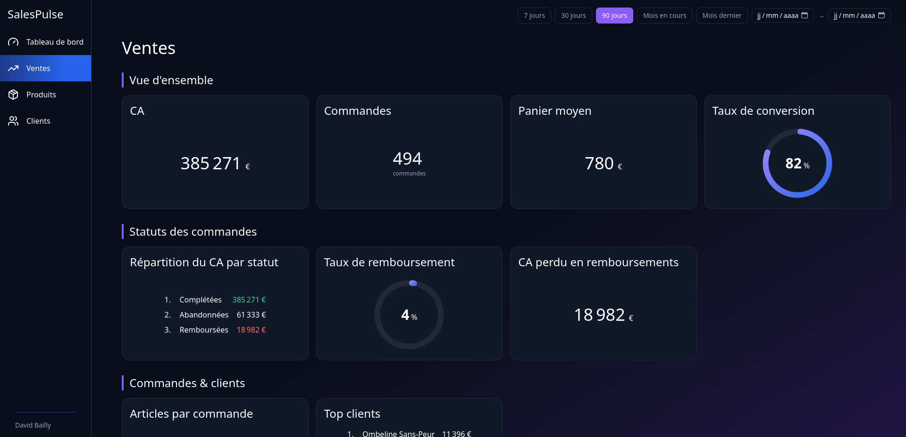

# SalesPulse



SalesPulse est un dashboard de monitoring des ventes pour une ou plusieurs boutiques e-commerce. Il donne une vue d'ensemble de l'activité (chiffre d'affaires, commandes, produits, clients) avec un niveau de détail différent selon la page.

L'application s'appuie sur des données mockées (trois boutiques fictives à thème heroic fantasy) : aucun backend réel n'est nécessaire pour la faire tourner, mais l'architecture est pensée pour en accueillir un par la suite.

**Démo en ligne :** [salespulse-e8yw.onrender.com](https://salespulse-e8yw.onrender.com)

## Pages

- **Dashboard** — les indicateurs les plus globaux, ceux qu'on veut voir en un coup d'œil
- **Ventes** — le détail des ventes et des commandes
- **Produits** — le détail du catalogue et des performances produits
- **Clients** — le détail de la base clients et de leur comportement d'achat
- **Analytics** — le trafic et son efficacité : acquisition, engagement, visites, rentabilité, fidélisation et qualité technique

## Sélecteur de boutique

Un sélecteur permet de consulter une boutique en particulier ou la vue **Toutes les boutiques** (par défaut). Il se trouve en haut de la barre latérale, et dans la barre du haut sur mobile, donc accessible à tout moment. La boutique choisie reste active quand on navigue entre les pages et quand on change de période (paramètre `?shop=` dans l'URL).

## Comparaison avec l'année précédente

Un interrupteur « Comparer à N-1 », à côté du filtre de dates, affiche sous chaque indicateur son évolution par rapport à la même période un an plus tôt (paramètre `?compare=yoy` dans l'URL, donc conservé quand on change de page, de boutique ou de période). La couleur dépend de la nature de l'indicateur : une hausse du chiffre d'affaires est verte, une hausse du taux de remboursement est rouge, une variation négligeable ou un indicateur sans sens clair reste gris. L'évolution est en pourcentage pour les montants et en points pour les taux. Les listes, le CAC et le ratio LTV/CAC n'ont pas d'évolution : l'historique du mock ne permet pas de les comparer correctement. Le mock génère pour cela une seconde fenêtre de 90 jours, un an plus tôt, avec une tendance volontairement variée.

## Démarrer le projet

```bash
npm install
npm run dev
```

L'application est ensuite accessible sur [http://localhost:3000](http://localhost:3000).

## Stack technique


